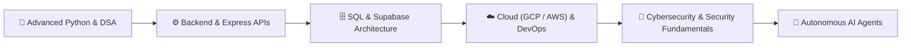

<!-- ==================== HEADER BANNER ==================== -->

<!-- ==================== DYNAMIC TYPING SVG ==================== -->

  <i>Building practical projects, exploring agentic AI, and turning ideas into working software. 🚀</i>

<!-- ==================== QUICK BADGES ==================== -->

  
  
  
  
  

---

## 👨‍💻 About Me

<table>
  <tr>
    <td width="55%" valign="top">
      <h3>Hey there! 👋</h3>
      

        I'm a second-year <b>BCA student from Nagpur, India</b> with a deep curiosity for software engineering, cloud systems, cybersecurity, and applied artificial intelligence.
      

      

        I love participating in <b>hackathons, competitive developer sprints, and building real-world software</b> from scratch. When I'm not writing code, I'm analyzing system architectures, learning Linux internals, or experimenting with autonomous AI agents.
      

      

        ⚡ <i>"I love turning random ideas into production-ready software prototypes!"</i>
      

    </td>
    <td width="45%" valign="top">
      <h3>⚡ Quick Highlights</h3>
      <ul>
        <li>🎓 <b>Degree:</b> Bachelor of Computer Applications (2nd Year)</li>
        <li>📍 <b>Location:</b> Nagpur, Maharashtra, India</li>
        <li>🧠 <b>Core Focus:</b> Backend Development, AI Agents & Cloud</li>
        <li>🎯 <b>Interests:</b> Full-Stack Systems, Cybersecurity & Hackathons</li>
        <li>🤝 <b>Collaboration:</b> Open to hackathons, AI tools & open source</li>
        <li>📫 <b>Reach Me:</b> <a href="mailto:123nilctz@gmail.com">123nilctz@gmail.com</a></li>
      </ul>
    </td>
  </tr>
</table>

---

## 🛠️ Tech Stack & Toolkit

### 💻 Programming & Scripting Languages

  
  
  
  
  

### 🌐 Frontend & Backend Development

  
  
  
  
  

### 🤖 AI, Machine Learning & Agentic Systems

  
  
  
  

### ☁️ Cloud, Databases & Backend-as-a-Service

  
  
  
  

### 🛠️ Developer Tools & Environments

  
  
  
  
  

---

## 🚀 Featured Projects & Hackathon Innovations

<table width="100%">
  <!-- ROW 1 -->
  <tr>
    <td width="50%" valign="top">
      <h3>🚇 <a href="https://github.com/nilesh0199/MetroMarg-GraphHacks-2026">MetroMarg</a></h3>
      

        
        
      

      

        A graph-powered Delhi Metro route analysis agent examining how unexpected station closures and dynamic line reroutes affect journeys toward Jantar Mantar.
      

      

        <b>Tech:</b> <code>Python</code> · <code>Graph Theory</code> · <code>AI Agents</code> · <code>Transit Data</code>
      

      

        <a href="https://github.com/nilesh0199/MetroMarg-GraphHacks-2026"><b>Explore MetroMarg →</b></a>
      

    </td>
    <td width="50%" valign="top">
      <h3>🛡️ <a href="https://github.com/nilesh0199/OfferClara-WisprFlow-Hackathon">OfferClara</a></h3>
      

        
        
      

      

        An AI-assisted job & internship offer review shield built for the <i>No Hands: The Wispr Challenge</i> (WeMakeDevs & Wispr Flow), helping applicants spot red flags before paying fees or sharing personal documents.
      

      

        <b>Tech:</b> <code>AI Analysis</code> · <code>Wispr Flow</code> · <code>Voice-first UX</code> · <code>Next.js</code>
      

      

        <a href="https://github.com/nilesh0199/OfferClara-WisprFlow-Hackathon"><b>Explore OfferClara →</b></a>
      

    </td>
  </tr>

  <!-- ROW 2 -->
  <tr>
    <td width="50%" valign="top">
      <h3>🔎 <a href="https://github.com/nilesh0199/LabelLens">LabelLens</a></h3>
      

        
        
      

      

        AI-powered compliance verification platform for packaged commodities. Automates packaging law checks using computer vision, multimodal document extraction, and regulatory rules.
      

      

        <b>Tech:</b> <code>Next.js</code> · <code>Vision API</code> · <code>Gemini</code> · <code>Supabase</code>
      

      

        <a href="https://github.com/nilesh0199/LabelLens"><b>Explore LabelLens →</b></a>
      

    </td>
    <td width="50%" valign="top">
      <h3>🎉 <a href="https://github.com/nilesh0199/ayojan_ace_promptwars_virtual_challenge5">Aayojan Ace</a></h3>
      

        
        
      

      

        An intelligent, culture-aware event orchestration platform built for PromptWars Virtual Challenge 5, generating personalized event budgets, ritual timelines, and vendor schedules.
      

      

        <b>Tech:</b> <code>Next.js</code> · <code>Google Gemini</code> · <code>Firebase</code>
      

      

        <a href="https://github.com/nilesh0199/ayojan_ace_promptwars_virtual_challenge5"><b>Explore Aayojan Ace →</b></a>
      

    </td>
  </tr>

  <!-- ROW 3 -->
  <tr>
    <td width="50%" valign="top">
      <h3>🧠 <a href="https://github.com/nilesh0199/nileshthipe_promptwars">Perspectra</a></h3>
      

        
        
      

      

        An AI-powered multi-perspective reasoning platform designed and built during <i>PromptWars: Build with AI</i>, an intensive 3-hour invite-only in-person development competition.
      

      

        <b>Tech:</b> <code>Gemini</code> · <code>Rapid Prototyping</code> · <code>Prompt Engineering</code>
      

      

        <a href="https://github.com/nilesh0199/nileshthipe_promptwars"><b>Explore Perspectra →</b></a>
      

    </td>
    <td width="50%" valign="top">
      <h3>🗳️ <a href="https://github.com/nilesh0199/civicSpark-PromptWars">CivicSpark</a></h3>
      

        
        
      

      

        An AI-powered civic education platform leveraging Google Gemini to help voters inspect ballot proposals, analyze voting behavior patterns, and uncover cognitive biases in political media.
      

      

        <b>Tech:</b> <code>Gemini API</code> · <code>Cognitive Analysis</code> · <code>JavaScript</code>
      

      

        <a href="https://github.com/nilesh0199/civicSpark-PromptWars"><b>Explore CivicSpark →</b></a>
      

    </td>
  </tr>

  <!-- ROW 4 -->
  <tr>
    <td width="50%" valign="top">
      <h3>🤖 <a href="https://github.com/nilesh0199/Kairox-AI-Agent-GenAI-Academy-Track-1-Project">Kairox AI Agent</a></h3>
      

        
        
      

      

        An autonomous career navigation copilot that structures personalized, month-by-month actionable skill roadmaps using Google Agent Development Kit (ADK) and Gemini models.
      

      

        <b>Tech:</b> <code>Google ADK</code> · <code>Gemini</code> · <code>Python</code> · <code>Agents</code>
      

      

        <a href="https://github.com/nilesh0199/Kairox-AI-Agent-GenAI-Academy-Track-1-Project"><b>Explore Kairox →</b></a>
      

    </td>
    <td width="50%" valign="top">
      <h3>🏙️ <a href="https://github.com/nilesh0199/NagarDrishti-AI">NagarDrishti AI</a></h3>
      

        
        
      

      

        A smart city analytics engine turning complex municipal metrics, citizen reports, and urban sensor datasets into actionable decision dashboards for city governance.
      

      

        <b>Tech:</b> <code>AI Data Analytics</code> · <code>Python</code> · <code>Urban Tech</code>
      

      

        <a href="https://github.com/nilesh0199/NagarDrishti-AI"><b>Explore NagarDrishti →</b></a>
      

    </td>
  </tr>

  <!-- ROW 5 -->
  <tr>
    <td width="50%" valign="top">
      <h3>📚 <a href="https://github.com/nilesh0199/flowpilot-ai">FlowPilot AI</a></h3>
      

        
        
      

      

        An AI-powered academic assistant designed to streamline student schedules, automate note synthesis, and coordinate study plans through a natural conversational chat interface.
      

      

        <b>Tech:</b> <code>Gemini</code> · <code>Conversational UX</code> · <code>Productivity</code>
      

      

        <a href="https://github.com/nilesh0199/flowpilot-ai"><b>Explore FlowPilot →</b></a>
      

    </td>
    <td width="50%" valign="top">
      <h3>📦 More Open Source & Experiments</h3>
      

        
        
      

      

        Check out more projects including <b><a href="https://github.com/nilesh0199/MinecraftBot">MinecraftBot</a></b> (automation bot), <b><a href="https://github.com/nilesh0199/free-llm-api-resources">free-llm-api-resources</a></b>, and <b><a href="https://github.com/nilesh0199/OpenSource-Github-Wall">OpenSource-Github-Wall</a></b>.
      

      

        <a href="https://github.com/nilesh0199?tab=repositories"><b>Browse All 15+ Repositories →</b></a>
      

    </td>
  </tr>
</table>

---

## 🏆 Highlights & Accolades

<table>
  <tr>
    <td width="33%" align="center">
      <h3>🥈 Second Prize</h3>
      
<b>Technoquest 2026</b>

      
Awarded 2nd prize for technical excellence and innovative software design.

    </td>
    <td width="33%" align="center">
      <h3>🇮🇳 SIH Contender</h3>
      
<b>Smart India Hackathon 2026</b>

      
Participant addressing PS <code>SIH26034</code> with the LabelLens compliance engine.

    </td>
    <td width="33%" align="center">
      <h3>⚡ PromptWars</h3>
      
<b>Challenge 5 & In-Person</b>

      
Built Aayojan Ace and Perspectra during high-pressure timed AI hackathons.

    </td>
  </tr>
</table>

  
<b>🔍 Click to view additional hackathon & learning milestones</b>

   
  <ul>
    <li>🚇 <b>Graph Hacks 2026:</b> Architected <b>MetroMarg</b>, a graph-theory AI agent exploring dynamic transit disruptions in the Delhi Metro network.</li>
    <li>🎙️ <b>Wispr Flow Hackathon:</b> Engineered <b>OfferClara</b> for <i>No Hands: The Wispr Challenge</i> by WeMakeDevs & Wispr Flow.</li>
    <li>🤖 <b>GenAI Academy Track 1:</b> Developed the <b>Kairox Career AI Agent</b> with Google Agent Development Kit (ADK) and Gemini.</li>
    <li>🌐 <b>Open Source:</b> Actively maintaining developer resources like free LLM endpoints and interactive web projects.</li>
  </ul>

 

  <b>🏅 Official GitHub Badges & Achievements</b>
    
  
  &nbsp;&nbsp;&nbsp;&nbsp;
  
  &nbsp;&nbsp;&nbsp;&nbsp;
  

---

## 🧠 Currently Learning & Roadmap

- 🐍 **Python & Problem Solving:** Deepening DSA knowledge and algorithmic problem-solving skills.
- ⚙️ **Backend Engineering:** Building performant, modular REST APIs using Node.js & Express.js.
- 🗄️ **Database Design:** Optimizing relational schemas, indexing, and data models with SQL & Supabase.
- 🐧 **Linux & Systems:** Mastering command-line tooling, bash automation, and Linux environments.
- ☁️ **Cloud Computing:** Hands-on deployments and architecture on Google Cloud Platform and AWS.
- 🔐 **Cybersecurity:** Learning web application security (OWASP Top 10), authentication, and defense.
- 🤖 **Agentic AI:** Developing multi-agent workflows, autonomous reasoning loops, and prompt systems.

---

## 📊 GitHub Analytics

  
  

    

  

---

## 🤝 Let's Connect & Collaborate

  

    Whether you have an exciting hackathon idea, want to build an open-source project together, or just want to chat about AI and tech — my inbox is always open!
  

  
  &nbsp;
  
  &nbsp;
  

    
  
  <i>"Always learning. Always building. Always curious." 🚀</i>

    

  <!-- ==================== FOOTER WAVE ==================== -->
  

